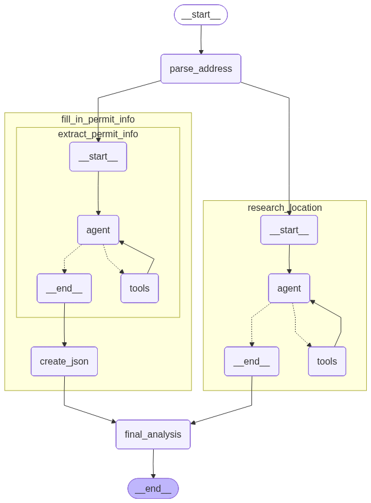

# Overview

The following multi-agent system was implemented:



A research agent was implemented as a ReAct agent with access to a web search tool. A permit agent was implemented as an agent with access to file search (simple RAG implementation). 

Simplifying assumptions were made for the permit agent. Emailed with Will re: an API for classifying jurisdiction, which costs $5000 annually. A real world implementation might involve hitting this API, determing the AHJ, retrieving from the web the permit applications for that authority. For the assignment, decided for simplicity to use the solar permit application template in the `assets` folder as an example template. The permit agent extracts information for the fields in that form to a json file.

The solution currently creates two artifacts: a research summary which is saved as a PDF file and the extracted permit json. The final analysis step is currently just a dummy passthrough of the research summary. Implementing it would involve writing a prompt, I just haven't gotten to this.

# How to run

IMPORTANT: Copy `sample.env` to `.env` and add your API keys to `.env`

## Set up python environment

I use conda. To set up a conda environment:

1. Install [conda](https://www.anaconda.com/download)
1. `conda env create -f environment.yml`
1. `conda activate climatize`

Alternatively you can set up a python virtual env using `requirements.txt`

## 1. UI with gradio

`python demo.py`

Open a browser to the URL indicated in the terminal (e.g. `http://127.0.0.1:7860`)

Use the mock data in `test_examples`, for example "9845 East Brown Road Mesa, AZ 85207" with ProjectPackage_Mesa.pdf.

ProjectPackage_SantaCruz.pdf is an attempt at generating more realistic sample document where the document isn't laid out like the permit data.

## 2. Python script

```python main.py --address "9845 East Brown Road Mesa, AZ 85207" --pdf_path ./test_examples/ProjectPackage_Mesa.pdf```

```python main.py --address "326 Coral St Santa Cruz CA" --pdf_path ./test_examples/ProjectPackage_SantaCruz.pdf``` 

## Unfinished: Docker implementation

Docker image builds but running fails, due to a problem with the `md2pdf` package used.

Build docker image:
`docker build -t climatize-agent .`

Running this docker container exits immediately
`docker run —env-file .env -v <PATH TO REPO>/test_examples/ProjectPackage_SantaCruz.pdf:/input/document.pdf climatize-agent --address "326 Coral St Santa Cruz CA" --pdf_path /input/document.pdf`

Digging into it:
`docker run -it --entrypoint /bin/bash  climatize-agent`
Then running `python main.py` you will see the following error:
```ImportError: cannot import name 'md2pdf' from 'md2pdf.core' (/usr/local/lib/python3.11/dist-packages/md2pdf/core.py)```

The `md2pdf/core.py` file is empty (0 bytes) in the container. This is an issue with the package. Some solutions would be to use different python package for handling markdown. Or having a dockerized app that just writes markdown to a text file without creating a nice PDF.

# Limitations

In the given time, there were many things that could not be done, besides the unfinished items described above. For example:
- Thorough testing. This was tested with two samples: Santa Cruz CA and Mesa AZ, using the generated mock PDFs.
- Exception handling. It is possible that other examples will hit exceptions not handled in the code.
- Obvious improvements, for example the project address does not need to be extracted from the documents (and in the Santa Cruz example, is extracted incorrectly).

# Future improvements: some examples

## Permit Agent
There are APIs and packages that might be a better out-of-the-box demo starting point, but for purposes of assignment did a "from scratch" implementation for illustration.

- Implemented "vanilla" RAG. Well-known limitations and there are a host of improvements that could be made for improved data extraction.
- Multiple passes to check incorrect / incomplete extracted permit data.
- Add validators to Pydantic data models (e.g. valid email string).
- Equip with calculator tool so it can convert units in input documents to units specified in permit application (e.g. acres to sq. ft.)
- Extend to be able to process multiple documents (straightforward code modifications)
